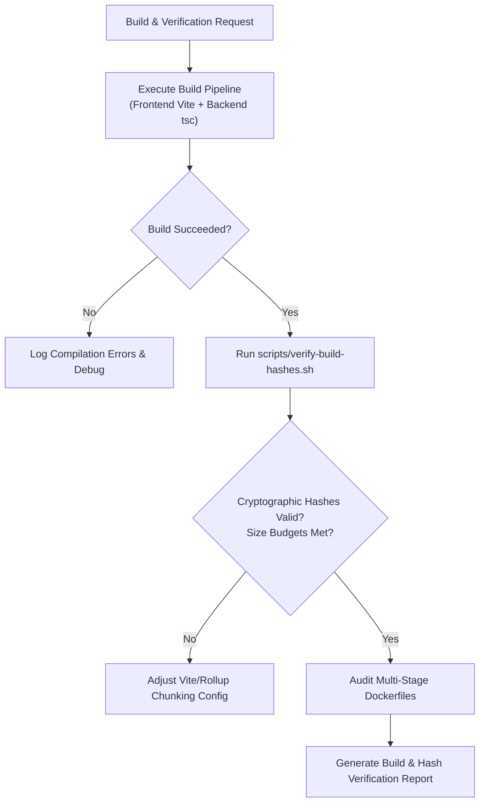

# Build & Hash Verification Skill

This skill provides automated workflows to build, inspect, and verify the integrity of compiled outputs for **NeutralStack Web** (`neutralstack-web`), in strict compliance with [`docs/build-spec.md`](file:///Users/rohithtp/mine/home/workspaces/neutralstack-web/docs/build-spec.md) and [`docs/architecture-spec.md`](file:///Users/rohithtp/mine/home/workspaces/neutralstack-web/docs/architecture-spec.md).

## Workflow



---

## Key Verification Checks

### 1. Frontend Asset Fingerprinting & Hashing
* **Hashing Rule:** Every production asset in `frontend/dist/assets/` must follow the deterministic naming schema:
  `[name].[hash].[ext]` (e.g., `index.a8f21bc9.js`, `style.73d2a901.css`).
* **HTML Integrity:** `frontend/dist/index.html` must dynamically reference the exact hashed assets generated in that specific build.
* **No Unhashed Leaks:** No raw `.js` or `.css` files (without hashes) should exist in `/assets/`.
* **Budget Limits:**
  * Initial JS bundle chunk: `<= 250 KB` (compressed/gzipped target `<= 80 KB`).
  * Initial CSS bundle chunk: `<= 50 KB`.

### 2. Backend TypeScript Compilation
* Validates `backend/tsconfig.json` produces cleanly structured CommonJS or ES Module output in `backend/dist/`.
* Verifies zero type errors (`tsc --noEmit`).
* Verifies entrypoint `backend/dist/server.js` resolves all local modules without runtime module missing errors.

### 3. Container & Docker Verification
* Validates `frontend/Dockerfile` multi-stage build:
  * Stage 1: node alpine build.
  * Stage 2: `nginxinc/nginx-unprivileged:alpine` with `frontend/nginx.conf`.
* Validates `backend/Dockerfile` multi-stage build:
  * Runs as unprivileged UID 1000.
  * Discards TypeScript compiler and devDependencies in the final stage.

---

## Executing Automated Build Verification

### Complete Build & Hash Verification:
```bash
bash .agents/skills/build-verification/scripts/verify-build.sh
```

### Hash & Asset Fingerprint Audit Only:
```bash
bash .agents/skills/build-verification/scripts/verify-build-hashes.sh frontend/dist
```

---

## Expected Header Verification (NGINX Static Delivery)

After building and serving the static distribution, verify response headers via curl:

```bash
# Fingerprinted asset: Immutable long-term cache
curl -I http://localhost:8080/assets/index.a8f21bc9.js
# Expected:
# Cache-Control: public, max-age=31536000, immutable
# X-Content-Type-Options: nosniff

# Dynamic entrypoint: Revalidation required
curl -I http://localhost:8080/index.html
# Expected:
# Cache-Control: no-cache, no-store, must-revalidate
```

