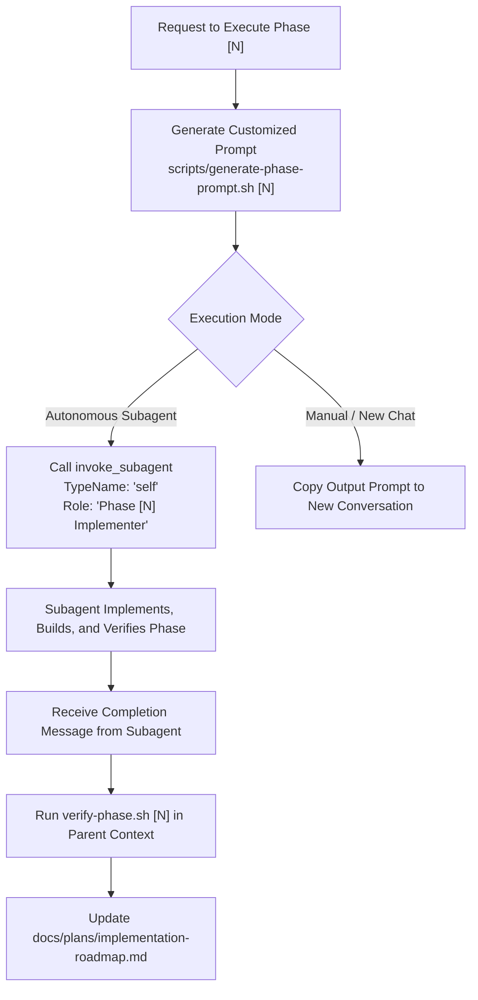

# Phase Executor Skill

This skill provides an automated workflow to implement, build, and verify roadmap phases for **NeutralStack Web** (`neutralstack-web`) in dedicated, isolated conversation contexts.

---

## Workflow



---

## 1. Generating the Reusable Execution Prompt

Run the prompt generator script specifying the phase number (`1` through `6`):

```bash
bash .agents/skills/phase-executor/scripts/generate-phase-prompt.sh 1
```

This outputs a fully hydrated prompt with:
* The phase title and target deliverables.
* The required specification references.
* The phase verification command (`verify-phase.sh [N]`).
* The build and cryptographic hash audit command (`verify-build.sh`).
* Roadmap update instructions.

---

## 2. Initiating a Dedicated Subagent Conversation

To run the phase implementation in an isolated subagent conversation with its own context window, call the `invoke_subagent` tool:

```json
{
  "TypeName": "self",
  "Role": "Phase 1 Implementer & Verifier",
  "Prompt": "<Output from scripts/generate-phase-prompt.sh 1>"
}
```

### Guidelines for Subagent Orchestration:
* **No Polling Required:** The system automatically notifies the parent agent when the subagent completes its task or needs guidance.
* **Workspace Sharing:** Use the default `Workspace: "inherit"` so the subagent writes files directly into the workspace.
* **Subagent Completion:** Once the subagent finishes, review its reported changes and run `bash .agents/skills/phase-verification/scripts/verify-phase.sh [N]` in the parent session to confirm all gates pass.

---

## 3. Supported Roadmap Phases

| Phase | Title | Focus Area |
| :--- | :--- | :--- |
| **Phase 1** | Workspace & Tooling | Root `package.json`, `.dockerignore`, `.env.example`, `.gitignore` |
| **Phase 2** | Frontend Engineering | React, Vite, Tailwind CSS, asset fingerprinting, `nginx.conf` |
| **Phase 3** | Backend Microservice | Fastify, TypeScript, validation schemas, security headers, probes |
| **Phase 4** | Containerization | Multi-stage non-root Dockerfiles, `docker-compose.yml` |
| **Phase 5** | Security Hardening | PKCS#12 certificate extraction pipeline, 30-day expiry monitoring |
| **Phase 6** | Declarative K3s | Manifests in `k8s/`, ingress path routing, Lighthouse & latency gates |

