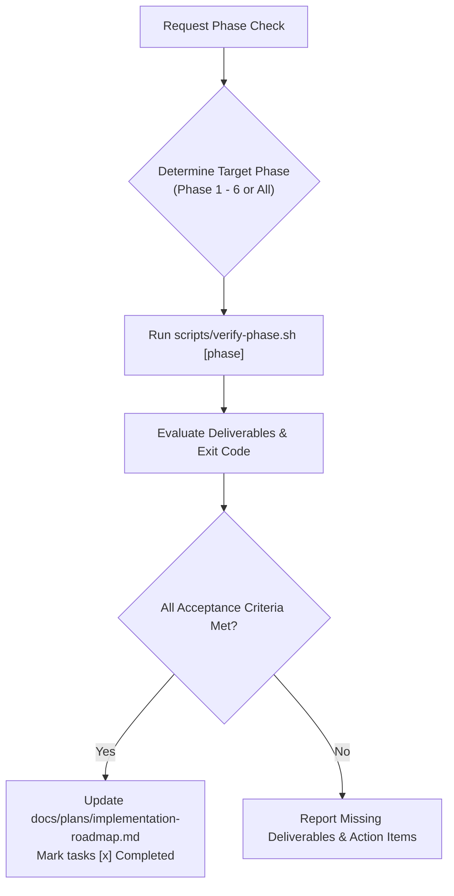

# Phase Verification Skill

This skill guides the inspection, verification, and status maintenance of implementation phases for **NeutralStack Web** (`neutralstack-web`), derived from [`docs/plans/implementation-roadmap.md`](file:///Users/rohithtp/mine/home/workspaces/neutralstack-web/docs/plans/implementation-roadmap.md).

## Workflow



---

## Verification Procedures by Phase

### Phase 1: Workspace & Tooling Initialization
1. Verify workspace structure:
   - Root `package.json` with workspace configuration (`frontend`, `backend`).
   - Root `.gitignore` enforcing secret & cert isolation (`*.p12`, `*.pem`, `.env*`).
   - `.dockerignore` preventing unneeded or sensitive context leaks.
   - `.env.example` defining runtime variable templates without real secrets.
2. Run automated validation:
   ```bash
   bash .agents/skills/phase-verification/scripts/verify-phase.sh 1
   ```

### Phase 2: Frontend Engineering (React + Vite + Tailwind CSS)
1. Verify `frontend/` directory structure:
   - `frontend/package.json`, `frontend/vite.config.ts`, `frontend/tsconfig.json`.
   - `frontend/tailwind.config.js` and `frontend/postcss.config.js`.
   - Component tree under `frontend/src/` with mobile-first breakpoints (`sm`, `md`, `lg`, `xl`).
   - `frontend/nginx.conf` with long-lived immutable cache directives for `/assets/*` and `no-cache` for `index.html`.
2. Run automated validation:
   ```bash
   bash .agents/skills/phase-verification/scripts/verify-phase.sh 2
   ```

### Phase 3: Backend Microservice (Fastify LTS)
1. Verify `backend/` directory structure:
   - `backend/package.json`, `backend/tsconfig.json`.
   - `backend/src/app.ts` (factory pattern) and `backend/src/server.ts` (graceful shutdown).
   - `@fastify/env` validation schemas under `backend/src/config/`.
   - Plugins (`@fastify/helmet`, `@fastify/cors`, `@fastify/rate-limit`).
   - Standard `/healthz` and `/readyz` probes.
2. Run automated validation:
   ```bash
   bash .agents/skills/phase-verification/scripts/verify-phase.sh 3
   ```

### Phase 4: Containerization & Local Orchestration
1. Verify multi-stage unprivileged Dockerfiles:
   - `frontend/Dockerfile` uses `nginxinc/nginx-unprivileged:alpine` or non-root user.
   - `backend/Dockerfile` runs under non-root UID 1000.
2. Verify `docker-compose.yml`:
   - Both frontend and backend services defined with network bridging.
3. Run automated validation:
   ```bash
   bash .agents/skills/phase-verification/scripts/verify-phase.sh 4
   ```

### Phase 5: Security Hardening & Certificate Lifecycle
1. Verify P12 extraction and monitoring scripts:
   - `scripts/extract-p12-certs.sh` present and executable.
   - `scripts/monitor-cert-expiry.sh` present and executable.
2. Verify zero-commit secret isolation:
   - Ensure `git status` shows no `.p12`, `.pem`, `.crt`, `.key`, or `.env` files.
3. Run automated validation:
   ```bash
   bash .agents/skills/phase-verification/scripts/verify-phase.sh 5
   ```

### Phase 6: Declarative K3s Deployment & Quality Gates
1. Verify Kubernetes manifests in `k8s/`:
   - `00-namespace.yaml` (`neutralstack-web`).
   - `01-configmap-secrets.yaml` (Twelve-Factor configuration).
   - `10-frontend-deployment.yaml` (probes, non-root context).
   - `20-backend-deployment.yaml` (probes, UID 1000).
   - `30-ingress.yaml` (path-based routing map).
2. Run automated validation:
   ```bash
   bash .agents/skills/phase-verification/scripts/verify-phase.sh 6
   ```

---

## Updating the Roadmap Status

Once a phase passes all automated verification checks:
1. Open [`docs/plans/implementation-roadmap.md`](file:///Users/rohithtp/mine/home/workspaces/neutralstack-web/docs/plans/implementation-roadmap.md).
2. Mark completed milestone items with `[x]`.
3. Update the phase status summary in the document.

