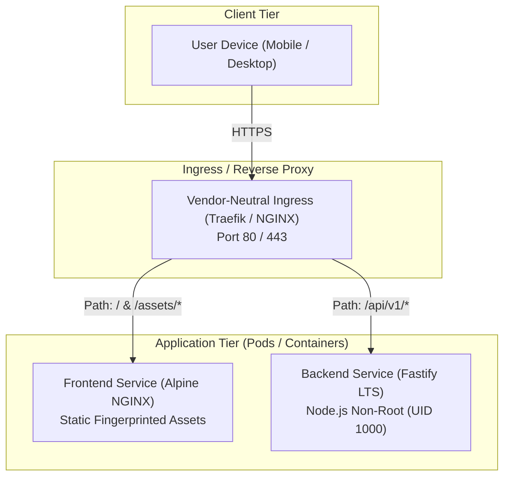

# NeutralStack Web (`neutralstack-web`)

> High-Performance, Vendor-Neutral Responsive Mobile-First Web Application

[](./LICENSE)
[](./docs/architecture-spec.md)
[](./docs/security-k3s-blueprint.md)

---

## 1. Overview & Architectural Tenets

**NeutralStack Web** is an enterprise-grade reference architecture for modern web applications designed without proprietary cloud runtime lock-in. It combines a mobile-first responsive frontend (React, Vite, Tailwind CSS) with a lightweight, high-throughput microservice backend (Fastify, Node.js LTS), orchestrated via standard OCI containers and declarative Kubernetes (K3s) manifests.

### Core Architectural Tenets
1. **Vendor Neutrality:** Standard POSIX conventions, standard OCI container images, and standard Kubernetes APIs. Zero proprietary cloud SDK bindings.
2. **Mobile-First Responsive Design:** UI layouts constructed from base mobile viewports (320px/375px) progressively scaling via Tailwind CSS breakpoints (`sm`, `md`, `lg`, `xl`).
3. **Immutable Static Delivery:** Static JS, CSS, and media assets are cryptographically fingerprinted with deterministic hashes and served with `Cache-Control: public, max-age=31536000, immutable`.
4. **Defense in Depth & Zero-Commit Secrets:** Non-root container runtimes, P12/TLS certificate isolation external to git, and strict source control guards.



---

## 2. Repository Layout

```text
neutralstack-web/
├── .agents/                        # Agent customizations & automation skills
│   └── skills/
│       ├── phase-verification/    # Roadmap progress & phase deliverable audits
│       ├── build-verification/    # Build runner & cryptographic hash audits
│       └── phase-executor/        # Subagent orchestrator & prompt generator
├── .gitignore                      # Strict zero-commit guards & build exclusions
├── .dockerignore                   # Container context optimization
├── LICENSE                         # MIT License
├── README.md                       # Project documentation entry point
├── docker-compose.yml              # Local multi-container development orchestration
├── docs/                           # Architectural and operational specifications
│   ├── architecture-spec.md        # System topology, frontend & backend design
│   ├── build-spec.md               # Bundling, fingerprinting, and Docker specs
│   ├── security-k3s-blueprint.md   # P12 certificate lifecycle & K3s deployment
│   ├── plans/                      # Implementation plans and engineering roadmaps
│   │   ├── README.md               # Directory overview & planning conventions
│   │   ├── implementation-roadmap.md # 6-phase engineering milestone tracker
│   │   └── prompts/                # Reusable prompts for subagents & new sessions
│   │       └── phase-implementation-prompt.md
│   └── skills/                     # Skill execution runbooks
│       ├── README.md
│       └── skill-usage-guide.md    # CLI & Chat operational guide
├── frontend/                       # React 19 / Vite / Tailwind CSS client
├── backend/                        # Fastify LTS microservice API
└── k8s/                            # Declarative K3s / Kubernetes manifests
```

---

## 3. Engineering Documentation & Specifications

All architectural decisions, build mechanics, and operational runbooks are formally documented:

* 📐 **[System Architecture Specification](file:///Users/rohithtp/mine/home/workspaces/neutralstack-web/docs/architecture-spec.md):** Complete component topology, network contracts, and caching tiers.
* 📦 **[Build & Packaging Specification](file:///Users/rohithtp/mine/home/workspaces/neutralstack-web/docs/build-spec.md):** Rollup chunking rules, hash fingerprinting, and multi-stage Dockerfiles.
* 🛡️ **[Security Architecture & K3s Blueprint](file:///Users/rohithtp/mine/home/workspaces/neutralstack-web/docs/security-k3s-blueprint.md):** P12 certificate extraction utility, expiration monitoring, and non-root execution.
* 🗺️ **[Implementation Roadmap](file:///Users/rohithtp/mine/home/workspaces/neutralstack-web/docs/plans/implementation-roadmap.md):** Phased milestone execution tracker from scaffolding to production readiness.
* 🛠️ **[Agent Skills Usage Guide](file:///Users/rohithtp/mine/home/workspaces/neutralstack-web/docs/skills/skill-usage-guide.md):** Complete operational runbook for executing skills from the shell (CLI/CI) and from chat (AI assistant/subagents).

---

## 4. Custom Verification Skills

This repository includes built-in AI agent skills in [`.agents/skills/`](file:///Users/rohithtp/mine/home/workspaces/neutralstack-web/.agents/skills/) to maintain code quality and verify phase deliverables:

### 🔍 Phase Verification (`phase-verification`)
Audits workspace completeness against [`docs/plans/implementation-roadmap.md`](file:///Users/rohithtp/mine/home/workspaces/neutralstack-web/docs/plans/implementation-roadmap.md):
```bash
# Verify all phases or a specific phase (1 - 6)
bash .agents/skills/phase-verification/scripts/verify-phase.sh all
bash .agents/skills/phase-verification/scripts/verify-phase.sh 1
```

### ⚡ Build & Hash Verification (`build-verification`)
Compiles workspaces and validates deterministic asset hashing and bundle budgets:
```bash
# Complete build & lint pipeline
bash .agents/skills/build-verification/scripts/verify-build.sh

# Cryptographic hash audit on built distribution
bash .agents/skills/build-verification/scripts/verify-build-hashes.sh frontend/dist
```

### 🚀 Phase Executor (`phase-executor`)
Generates customized execution prompts to initiate an isolated subagent or new conversation context for implementing and verifying any phase:
```bash
# Generate prompt for a phase (e.g. Phase 1)
bash .agents/skills/phase-executor/scripts/generate-phase-prompt.sh 1
```

---

## 5. Development & Verification Workflow

### Prerequisites
* **Node.js:** v20.x or v22.x LTS
* **npm:** v10.x or pnpm v9.x
* **Docker Engine & Docker Compose:** v24+
* **kubectl & K3s:** (for local cluster validation)
* **OpenSSL:** (for certificate extraction testing)

### Quick Start (Local Development)
```bash
# Install workspace dependencies
npm install

# Start frontend and backend concurrently in development mode
npm run dev

# Or run via Docker Compose
docker compose up --build
```

### Quality & Resilience Targets
| Dimension | Benchmark Specification |
| :--- | :--- |
| **Lighthouse Score** | Mobile Performance > 90, Accessibility = 100, Best Practices = 100, SEO = 100 |
| **API Latency (p95)** | < 30ms for non-blocking endpoints |
| **Container Memory** | Frontend < 32MB RSS; Backend < 128MB RSS |
| **Security Audit** | Zero tracked `.env*`, `*.p12`, `*.pem`, `*.key`, `*.crt` files in git |

---

## 6. License

This project is licensed under the [MIT License](./LICENSE).

