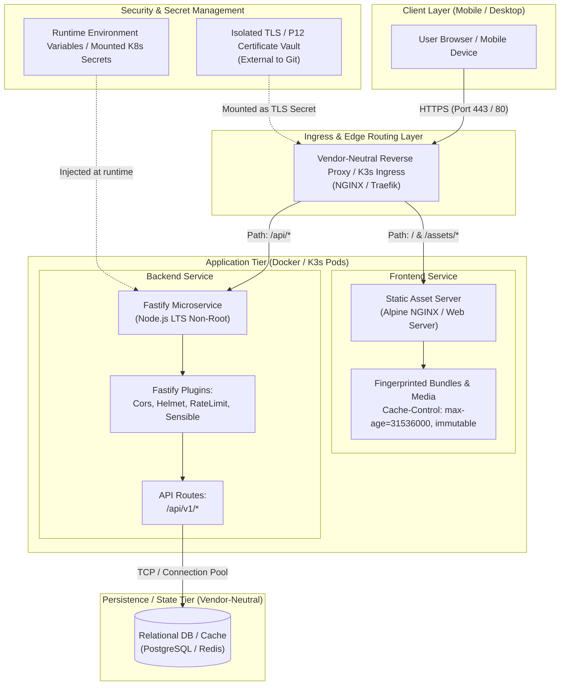

# System Architecture Specification

**Project:** NeutralStack Web (`neutralstack-web`) - Vendor-Neutral Responsive Mobile-First Application  
**Version:** 1.0.0-POC  
**Status:** Approved Architecture Draft  

---

## 1. Executive Summary & Architectural Tenets

This architecture specification details the system design for a high-performance, vendor-neutral web application featuring a mobile-first responsive frontend built with React, Vite, and Tailwind CSS, orchestrated against a lightweight Fastify Node.js microservice backend.

### Architectural Tenets
1. **Vendor Neutrality:** Zero proprietary cloud runtime lock-in. All compute, ingress, configuration, and storage primitives adhere to standard OCI container specifications, standard POSIX environment conventions, and standard Kubernetes (K8s/K3s) APIs.
2. **Mobile-First Responsive Design:** UI layouts are constructed starting from minimum mobile viewports (320px/375px) using CSS Flexbox and Grid, scaling progressively to larger breakpoints.
3. **Immutable Static Delivery:** Static assets (JS, CSS, images, fonts) are cryptographically fingerprinted during the build phase and delivered with immutable, long-lived HTTP caching directives (`Cache-Control: public, max-age=31536000, immutable`).
4. **Defense in Depth:** Zero hardcoded secrets, isolated credential workflows (P12/TLS bundles kept external to source control), non-root container runtimes, and principle of least privilege across network tiers.

---

## 2. High-Level System Architecture & Component Topology



---

## 3. Frontend Architecture (React + Vite + Tailwind CSS)

### 3.1 Stack Selection Rationale
* **React 19 / 18:** Declarative component model, ecosystem maturity, and concurrent rendering support.
* **Vite:** High-performance native ESM dev server and Rollup-powered production bundler generating optimized static assets.
* **Tailwind CSS:** Utility-first styling engine avoiding CSS runtime overhead, enabling consistent mobile-first breakpoint systems.

### 3.2 Mobile-First Viewport & Breakpoint Strategy
All design tokens and styles start at base (mobile) and use min-width media queries:

| Breakpoint Prefix | Min Width | Target Devices | Layout Behavior |
| :--- | :--- | :--- | :--- |
| *Default (None)* | `0px - 639px` | Mobile handsets (iPhone, Pixel) | 1-column stack, collapsible drawer navigation, full-width touch targets (min 44x44px). |
| `sm:` | `640px` | Large phones / Phablets | 2-column flex cards, adjusted typography. |
| `md:` | `768px` | Tablets / Small iPads | Multi-column grid, persistent sub-nav. |
| `lg:` | `1024px` | Laptops / Desktops | Horizontal header nav, multi-column dashboard layout. |
| `xl:` | `1280px` | Wide desktop displays | Max-width content boundary with fluid margins. |

### 3.3 Asset Fingerprinting & Caching Architecture
Static assets must be divided into two distinct caching classes:

1. **Fingerprinted Assets (`/assets/*.[hash].[ext]`):**
   * Generated by Rollup/Vite.
   * Response Headers:
     ```http
     Cache-Control: public, max-age=31536000, immutable
     X-Content-Type-Options: nosniff
     ```
2. **Dynamic Entry Point (`index.html`):**
   * Never cached indefinitely; must revalidate to serve updated hash references.
   * Response Headers:
     ```http
     Cache-Control: no-cache, no-store, must-revalidate
     Pragma: no-cache
     Expires: 0
     ```

### 3.4 Runtime Configuration Injection
* Build-time variables (`VITE_API_URL`) are avoided in vendor-neutral production builds.
* Instead, the frontend uses relative paths (`/api/v1`) routed by the Ingress/Reverse Proxy layer, or reads a runtime configuration object injected via an inline `<script id="__APP_CONFIG__">` tag or `/config.json` endpoint.

---

## 4. Backend Architecture (Fastify Framework)

### 4.1 Framework Profile & Performance Architecture
Fastify is selected for its high throughput (up to 2-3x Express.js), low memory footprint, and native support for schema-based JSON serialization.

### 4.2 Modular Plugin Architecture
The server is structured around Fastify’s encapsulated plugin system:

```
backend/
├── src/
│   ├── app.ts                 # Fastify app factory
│   ├── server.ts              # Entry point (port binding, signal handling)
│   ├── config/
│   │   └── env.ts             # Schema-validated environment config (@fastify/env)
│   ├── plugins/
│   │   ├── cors.ts            # CORS configuration
│   │   ├── helmet.ts          # Security response headers
│   │   ├── rate-limit.ts      # Rate limiter
│   │   └── health.ts          # Liveness & readiness probes
│   ├── routes/
│   │   └── api/
│   │       └── v1/
│   │           ├── landing.ts # Landing page interactive endpoints
│   │           └── contact.ts # Form submissions / Leads
│   └── schemas/               # Shared JSON / TypeBox validation schemas
```

### 4.3 Vendor-Neutral Configuration Model
* The backend strictly adheres to Twelve-Factor App configuration principles:
  * Reads standard environment variables (`PORT`, `HOST`, `DATABASE_URL`, `CORS_ORIGIN`).
  * Default bind host is `0.0.0.0` inside containers.
  * No dependency on proprietary cloud SDKs (e.g., AWS Secrets Manager SDK, Azure Key Vault SDK). Secrets are abstracted into standard filesystem mounts or environment variables.

---

## 5. Network, Protocol & Routing Contract

### 5.1 Ingress Path Routing Map
All incoming external traffic passes through the reverse proxy / ingress controller on standard HTTP/HTTPS ports (80/443):

| Path Pattern | Target Upstream | Caching Rule | Notes |
| :--- | :--- | :--- | :--- |
| `/assets/*` | `frontend-service:80` | `max-age=31536000, immutable` | Static JS, CSS, images |
| `/api/v1/*` | `backend-service:5000` | `no-cache, no-store` | Fastify REST API |
| `/healthz` | `backend-service:5000` | `no-cache` | K3s Liveness Probe |
| `/readyz` | `backend-service:5000` | `no-cache` | K3s Readiness Probe |
| `/*` (Fallback) | `frontend-service:80` | `no-cache` | Serves `index.html` (SPA routing) |

### 5.2 API Data Contract & Error Standards
All API endpoints return standard RFC 7807 problem details or uniform JSON responses:

* **Success Envelope:**
  ```json
  {
    "success": true,
    "data": {},
    "timestamp": "2026-10-29T06:00:00Z"
  }
  ```
* **Error Envelope:**
  ```json
  {
    "success": false,
    "error": {
      "code": "VALIDATION_ERROR",
      "message": "Invalid email address format",
      "details": []
    },
    "timestamp": "2026-10-29T06:00:00Z"
  }
  ```

---

## 6. Non-Functional Requirements & Resilience Targets

| Dimension | Target Specification |
| :--- | :--- |
| **Lighthouse Score** | Mobile Performance > 90, Accessibility = 100, Best Practices = 100, SEO = 100 |
| **API Latency (p95)** | < 30ms for standard non-blocking endpoints |
| **Container Memory** | Frontend < 32MB RSS; Backend < 128MB RSS |
| **Process Lifecycle** | Graceful shutdown handling `SIGTERM` and `SIGINT` (30s deadline) |
| **Zero Downtime** | Rolling updates via K3s Deployments with readiness probes |

