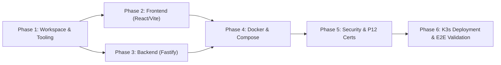

# Implementation Roadmap: NeutralStack Web

**Project:** NeutralStack Web (`neutralstack-web`)  
**Version:** 1.0.0-POC  
**Status:** Approved Engineering Plan  
**Related Specs:**
* [`../architecture-spec.md`](../architecture-spec.md)
* [`../build-spec.md`](../build-spec.md)
* [`../security-k3s-blueprint.md`](../security-k3s-blueprint.md)

---

## 1. Overview & Objectives

The goal of this roadmap is to translate the vendor-neutral, mobile-first responsive architecture into an operational production-grade codebase with zero cloud runtime lock-in.

### Key Milestones
1. **Phase 1: Workspace & Tooling Initialization** - Multi-package repository structure and dev environment.
2. **Phase 2: Frontend Implementation (React + Vite + Tailwind)** - Mobile-first responsive UI with deterministic asset fingerprinting.
3. **Phase 3: Backend Implementation (Fastify LTS)** - High-throughput microservice with schema validation and security plugins.
4. **Phase 4: Containerization & Local Orchestration** - Multi-stage non-root OCI images and Docker Compose setup.
5. **Phase 5: Security Guardrails & Certificate Lifecycle** - P12 certificate extraction pipeline, zero-commit isolation, and automated expiry monitoring.
6. **Phase 6: Declarative K3s Deployment & Verification** - Ingress path routing, health checks, Lighthouse performance audits, and acceptance testing.

---

## 2. Phase-by-Phase Execution Plan

---

### Phase 1: Workspace & Tooling Initialization

- [ ] **1.1 Multi-package Workspace Scaffolding:**
  - Initialize root `package.json` with npm / pnpm workspace definitions (`frontend`, `backend`).
  - Configure root formatting and linting (Prettier, ESLint).
- [ ] **1.2 Dockerignore & Environment Templates:**
  - Create `.dockerignore` to exclude node_modules, build caches, and sensitive keys.
  - Create `.env.example` templates for local dev variables.
- [ ] **1.3 Verification:**
  - Verify `.gitignore` rejects `.env*`, `*.p12`, `*.pem`, `*.key`, `dist/`, and `node_modules/`.

---

### Phase 2: Frontend Engineering (React + Vite + Tailwind CSS)

- [ ] **2.1 Vite & TypeScript Setup:**
  - Scaffold `frontend/` using Vite + React + TypeScript template.
  - Configure path aliases (`@/` -> `frontend/src/`).
- [ ] **2.2 Tailwind CSS Mobile-First Configuration:**
  - Install Tailwind CSS and PostCSS.
  - Configure breakpoints: default (mobile 0–639px), `sm` (640px), `md` (768px), `lg` (1024px), `xl` (1280px).
- [ ] **2.3 Responsive Component Hierarchy:**
  - Implement fluid mobile drawer navigation and touch-friendly interactive targets (min 44×44px).
  - Implement responsive cards, grid system, and vendor-neutral showcase sections.
- [ ] **2.4 Asset Fingerprinting & Caching:**
  - Configure Rollup chunking rules in `frontend/vite.config.ts` (`assets/[name].[hash].[ext]`).
  - Configure `frontend/nginx.conf` with long-lived immutable cache headers for `/assets/*` and `no-cache` for `index.html`.

---

### Phase 3: Backend Microservice (Fastify)

- [ ] **3.1 Server & Fastify App Scaffolding:**
  - Scaffold `backend/` with TypeScript configuration (`backend/tsconfig.json`).
  - Implement application factory (`backend/src/app.ts`) and process lifecycle handler (`backend/src/server.ts`).
- [ ] **3.2 Schema-Validated Configuration & Plugins:**
  - Implement environment variable validation with `@fastify/env` and TypeBox schemas.
  - Register `@fastify/helmet` with vendor-neutral CSP headers.
  - Register `@fastify/cors` with configurable origin binding.
  - Register `@fastify/rate-limit` for DDoS / brute-force mitigation.
- [ ] **3.3 Probes & API Routes:**
  - Implement standard `/healthz` (liveness) and `/readyz` (readiness) probes.
  - Implement `/api/v1/landing` and `/api/v1/contact` endpoints with RFC 7807 error envelopes.

---

### Phase 4: Containerization & Local Orchestration

- [ ] **4.1 Multi-Stage Frontend Container (`frontend/Dockerfile`):**
  - Stage 1: Build static assets using Node.js alpine image.
  - Stage 2: Serve via unprivileged non-root NGINX (`nginxinc/nginx-unprivileged:alpine`) on port 8080/80.
- [ ] **4.2 Multi-Stage Backend Container (`backend/Dockerfile`):**
  - Stage 1: Compile TypeScript into `dist/`.
  - Stage 2: Production runtime with Node.js LTS, running as unprivileged user (UID `1000`).
- [ ] **4.3 Local Orchestration (`docker-compose.yml`):**
  - Define `frontend` and `backend` services.
  - Connect via internal bridge network with port mapping for local preview.

---

### Phase 5: Security Hardening & Certificate Lifecycle

- [ ] **5.1 P12 Certificate Pipeline:**
  - Implement `scripts/extract-p12-certs.sh` to extract `tls.crt` and `tls.key` into a protected directory and create the K3s secret imperatively.
  - Ensure temporary extraction files are shredded post-creation.
- [ ] **5.2 Certificate Expiration Monitoring:**
  - Implement `scripts/monitor-cert-expiry.sh` to parse in-cluster secrets and alert when validity is under 30 days.
- [ ] **5.3 Secret Isolation Audit:**
  - Run git checks to guarantee no certificates, private keys, or `.env` files are tracked.

---

### Phase 6: Declarative K3s Deployment & Quality Gates

- [ ] **6.1 K3s Manifests (`k8s/`):**
  - `00-namespace.yaml`: Isolated `neutralstack-web` namespace.
  - `01-configmap-secrets.yaml`: Twelve-factor configs and environment secrets.
  - `10-frontend-deployment.yaml`: Deployment with readiness/liveness probes and unprivileged security context.
  - `20-backend-deployment.yaml`: Fastify deployment with non-root UID 1000 and resource limits.
  - `30-ingress.yaml`: Ingress controller routing `/assets/*` and `/*` to frontend, `/api/v1/*` to backend, with TLS termination.
- [ ] **6.2 Performance & Acceptance Quality Gates:**
  - Lighthouse mobile audit: Performance > 90, Accessibility = 100, Best Practices = 100, SEO = 100.
  - API Latency: p95 < 30ms for non-blocking endpoints.
  - Zero-downtime rolling restart validation under simulated load.

---

## 3. Plan Maintenance & Change Protocol

* Any modification to architectural invariants requires an update to both [`../architecture-spec.md`](../architecture-spec.md) and this roadmap.
* As milestones are completed, task checkboxes must be updated to reflect current implementation state.

