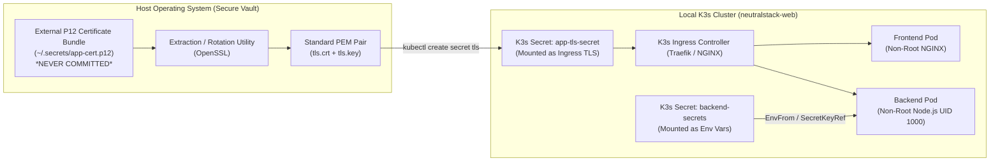

# Security Architecture & K3s Validation Blueprint

**Project:** NeutralStack Web (`neutralstack-web`) - Vendor-Neutral Responsive Mobile-First Application  
**Version:** 1.0.0-POC  
**Status:** Approved Security & K3s Blueprint  

---

## 1. Threat Model & Security Posture

This specification establishes runtime compliance, certificate isolation, zero-hardcoding secret management, and K3s-based local production validation.



---

## 2. Secrets Management & Zero-Commit Isolation

### 2.1 Storage & Runtime Injection Protocol
* **Source Control Guard:** Repository `.gitignore` rejects `.env*`, `*.p12`, `*.pfx`, `*.pem`, `*.key`, `*.crt`.
* **Runtime Injection:**
  * For local Docker Compose: read via host environment or untracked `.env` file loaded at runtime (`docker compose --env-file .env.local up`).
  * For K3s: injected strictly via Kubernetes `Secret` resources created imperatively or through sealed/external secrets.
* **Non-Root Execution:** Container runtimes run as unprivileged users (UID `101` for NGINX, UID `1000` for Node) with `readOnlyRootFilesystem: true` wherever feasible.

---

## 3. P12 Certificate Lifecycle & Expiration Monitoring

### 3.1 P12 Isolation Architecture
PKCS#12 (`.p12` / `.pfx`) identity archives contain sensitive private keys and certificate chains:
1. P12 files **must reside strictly outside the workspace tree** (e.g., `~/.certs/poc/` or in a secure secret manager).
2. The extraction utility converts the P12 archive into standard Kubernetes-compatible PEM artifacts:

```bash
#!/usr/bin/env bash
# scripts/extract-p12-certs.sh
set -euo pipefail

P12_PATH="${1:-$HOME/.certs/app-identity.p12}"
P12_PASS="${2:-changeit}"
TARGET_DIR="${3:-/tmp/k8s-certs}"

mkdir -p "$TARGET_DIR"
chmod 700 "$TARGET_DIR"

echo "==> Extracting Certificate from $P12_PATH..."
openssl pkcs12 -in "$P12_PATH" -clcerts -nokeys -out "$TARGET_DIR/tls.crt" -passin "pass:$P12_PASS"

echo "==> Extracting Private Key from $P12_PATH..."
openssl pkcs12 -in "$P12_PATH" -nocerts -nodes -out "$TARGET_DIR/tls.key" -passin "pass:$P12_PASS"

chmod 600 "$TARGET_DIR/tls.key"
chmod 644 "$TARGET_DIR/tls.crt"

echo "==> Certs extracted to $TARGET_DIR. Creating K3s TLS Secret..."
kubectl create secret tls neutralstack-tls-cert \
  --namespace=neutralstack-web \
  --cert="$TARGET_DIR/tls.crt" \
  --key="$TARGET_DIR/tls.key" \
  --dry-run=client -o yaml | kubectl apply -f -

# Shred temporary raw keys
rm -rf "$TARGET_DIR"
echo "==> Secret successfully mounted into K3s and temporary keys purged."
```

### 3.2 Automated Expiration Monitoring
An automated monitoring check alerts when certificates are within 30 days of expiry:

```bash
#!/usr/bin/env bash
# scripts/monitor-cert-expiry.sh
set -euo pipefail

NAMESPACE="neutralstack-web"
SECRET_NAME="neutralstack-tls-cert"
EXPIRY_WINDOW_SECONDS=2592000 # 30 days

echo "Checking certificate expiration for secret $SECRET_NAME in $NAMESPACE..."

# Extract cert from live cluster
CERT_DATA=$(kubectl get secret "$SECRET_NAME" -n "$NAMESPACE" -o jsonpath='{.data.tls\.crt}' | base64 -d)

# Check validity against threshold
if echo "$CERT_DATA" | openssl x509 -checkend "$EXPIRY_WINDOW_SECONDS" -noout; then
    EXPIRY_DATE=$(echo "$CERT_DATA" | openssl x509 -enddate -noout | cut -d= -f2)
    echo "[OK] Certificate is valid beyond 30 days. Expires on: $EXPIRY_DATE"
    exit 0
else
    echo "[ALERT] Certificate expires in less than 30 days or is already expired!"
    exit 1
fi
```

---

## 4. Declarative K3s Validation Manifests

The complete system is validated locally in K3s using vendor-neutral manifests placed under `k8s/`.

### 4.1 Namespace (`k8s/00-namespace.yaml`)
```yaml
apiVersion: v1
kind: Namespace
metadata:
  name: neutralstack-web
  labels:
    app.kubernetes.io/part-of: neutralstack-web
```

### 4.2 Configurations & Secrets (`k8s/01-configmap-secrets.yaml`)
```yaml
apiVersion: v1
kind: ConfigMap
metadata:
  name: backend-config
  namespace: neutralstack-web
data:
  NODE_ENV: "production"
  PORT: "5000"
  HOST: "0.0.0.0"
  CORS_ORIGIN: "https://neutralstack.local"
---
apiVersion: v1
kind: Secret
metadata:
  name: backend-secrets
  namespace: neutralstack-web
type: Opaque
stringData:
  API_SECRET_KEY: "poc-secure-sample-key-change-in-prod"
```

### 4.3 Frontend Deployment & Service (`k8s/10-frontend-deployment.yaml`)
```yaml
apiVersion: apps/v1
kind: Deployment
metadata:
  name: frontend
  namespace: neutralstack-web
  labels:
    app: frontend
spec:
  replicas: 2
  selector:
    matchLabels:
      app: frontend
  template:
    metadata:
      labels:
        app: frontend
    spec:
      securityContext:
        runAsNonRoot: true
        runAsUser: 101 # nginx unprivileged
      containers:
        - name: frontend
          image: neutralstack-frontend:latest
          imagePullPolicy: IfNotPresent
          ports:
            - containerPort: 8080
          resources:
            requests:
              cpu: "50m"
              memory: "32Mi"
            limits:
              cpu: "200m"
              memory: "64Mi"
          livenessProbe:
            httpGet:
              path: /
              port: 8080
            initialDelaySeconds: 5
            periodSeconds: 15
          readinessProbe:
            httpGet:
              path: /
              port: 8080
            initialDelaySeconds: 2
            periodSeconds: 5
---
apiVersion: v1
kind: Service
metadata:
  name: frontend-service
  namespace: neutralstack-web
spec:
  type: ClusterIP
  ports:
    - port: 8080
      targetPort: 8080
      protocol: TCP
  selector:
    app: frontend
```

### 4.4 Backend Fastify Deployment & Service (`k8s/20-backend-deployment.yaml`)
```yaml
apiVersion: apps/v1
kind: Deployment
metadata:
  name: backend
  namespace: neutralstack-web
  labels:
    app: backend
spec:
  replicas: 2
  selector:
    matchLabels:
      app: backend
  template:
    metadata:
      labels:
        app: backend
    spec:
      securityContext:
        runAsNonRoot: true
        runAsUser: 1000 # node user
      containers:
        - name: backend
          image: neutralstack-backend:latest
          imagePullPolicy: IfNotPresent
          ports:
            - containerPort: 5000
          envFrom:
            - configMapRef:
                name: backend-config
            - secretRef:
                name: backend-secrets
          resources:
            requests:
              cpu: "100m"
              memory: "64Mi"
            limits:
              cpu: "300m"
              memory: "128Mi"
          livenessProbe:
            httpGet:
              path: /healthz
              port: 5000
            initialDelaySeconds: 10
            periodSeconds: 10
          readinessProbe:
            httpGet:
              path: /readyz
              port: 5000
            initialDelaySeconds: 5
            periodSeconds: 5
---
apiVersion: v1
kind: Service
metadata:
  name: backend-service
  namespace: neutralstack-web
spec:
  type: ClusterIP
  ports:
    - port: 5000
      targetPort: 5000
      protocol: TCP
  selector:
    app: backend
```

### 4.5 Vendor-Neutral Ingress (`k8s/30-ingress.yaml`)
```yaml
apiVersion: networking.k8s.io/v1
kind: Ingress
metadata:
  name: neutralstack-ingress
  namespace: neutralstack-web
  annotations:
    ingress.kubernetes.io/ssl-redirect: "true"
spec:
  tls:
    - hosts:
        - neutralstack.local
      secretName: neutralstack-tls-cert
  rules:
    - host: neutralstack.local
      http:
        paths:
          - path: /api
            pathType: Prefix
            backend:
              service:
                name: backend-service
                port:
                  number: 5000
          - path: /
            pathType: Prefix
            backend:
              service:
                name: frontend-service
                port:
                  number: 8080
```

---

## 5. Local K3s Validation Execution Runbook

Developers follow this step-by-step checklist to validate the full multi-component deployment locally:

```bash
# 1. Start local K3s (or lightweight Rancher Desktop / k3d)
k3d cluster create neutralstack-cluster --port "80:80@loadbalancer" --port "443:443@loadbalancer"

# 2. Build local images
docker build -t neutralstack-frontend:latest ./frontend
docker build -t neutralstack-backend:latest ./backend

# 3. Import images into K3s (avoiding external registry dependency)
k3d image import neutralstack-frontend:latest neutralstack-backend:latest -c neutralstack-cluster

# 4. Apply Kubernetes Manifests
kubectl apply -f k8s/00-namespace.yaml
kubectl apply -f k8s/01-configmap-secrets.yaml
kubectl apply -f k8s/10-frontend-deployment.yaml
kubectl apply -f k8s/20-backend-deployment.yaml
kubectl apply -f k8s/30-ingress.yaml

# 5. Verify Pod Rollout and Health
kubectl get pods -n neutralstack-web -o wide
kubectl get ingress -n neutralstack-web

# 6. Verify Asset Caching Headers
curl -I http://localhost/assets/index.*.js | grep -i "cache-control"
# Expected: Cache-Control: public, max-age=31536000, immutable

# 7. Verify API Response
curl -s http://localhost/api/v1/health | jq .
```

