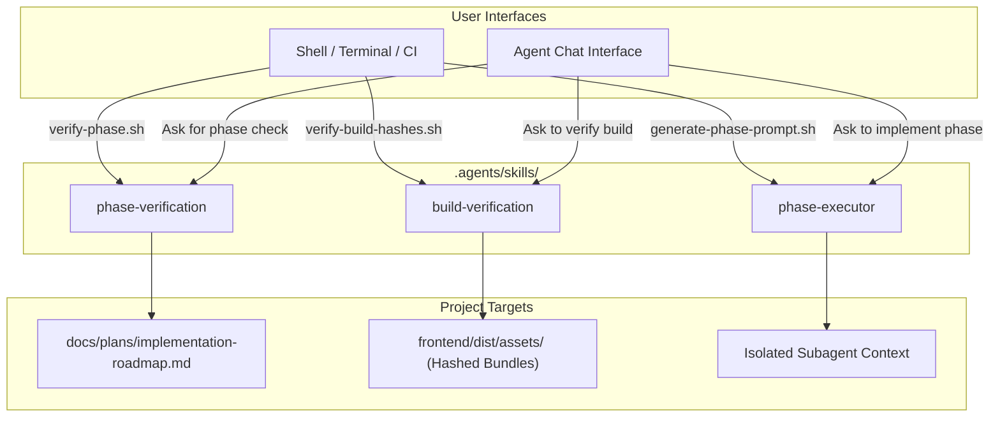

# Agent Skills Usage Guide: Shell & Chat Workflows

**Project:** NeutralStack Web (`neutralstack-web`)  
**Scope:** Workspace Agent Skills in `.agents/skills/`  
**Audience:** Developers, DevOps Engineers, and AI Pair-Programming Agents  

---

## 1. Overview & Skill Architecture

NeutralStack Web provides three specialized workspace skills located under [`.agents/skills/`](file:///Users/rohithtp/mine/home/workspaces/neutralstack-web/.agents/skills/):

```text
.agents/skills/
├── phase-verification/       # Verifies deliverables for Phases 1 through 6
├── build-verification/       # Audits asset hashes, bundles, and container builds
└── phase-executor/           # Generates execution prompts & spawns subagents
```

These skills can be operated through two primary interfaces:
1. **From the Shell (CLI / CI/CD):** Direct execution of deterministic Bash scripts for local development and automated pipelines.
2. **From Chat (AI Assistant):** Natural language prompts triggering agentic reasoning, autonomous subagent delegation, and automated roadmap maintenance.



---

## 2. Usage From Shell (CLI & CI/CD)

All skills include standalone, zero-dependency Bash scripts in their `scripts/` directories.

### 2.1 `phase-verification` Script Reference

The phase verification script inspects workspace structure, configuration files, and git history for zero-commit security compliance.

#### Syntax:
```bash
bash .agents/skills/phase-verification/scripts/verify-phase.sh [PHASE_NUMBER|all]
```

#### Examples:
```bash
# Verify Phase 1 (Workspace & Tooling Initialization)
bash .agents/skills/phase-verification/scripts/verify-phase.sh 1

# Verify Phase 5 (Security Hardening & Zero-Commit Secret Audit)
bash .agents/skills/phase-verification/scripts/verify-phase.sh 5

# Audit all 6 phases at once
bash .agents/skills/phase-verification/scripts/verify-phase.sh all
```

#### Exit Codes & CI Integration:
* `0`: All checks passed.
* `1`: One or more deliverables or pattern assertions failed.

```yaml
# Example GitHub Actions / CI step:
- name: Audit Implementation Phase 1
  run: bash .agents/skills/phase-verification/scripts/verify-phase.sh 1
```

---

### 2.2 `build-verification` Script Reference

#### Complete Build & Container Lint Pipeline (`verify-build.sh`):
Runs frontend and backend builds (if package manifests exist), audits asset hashes, and validates container non-root directives.

```bash
bash .agents/skills/build-verification/scripts/verify-build.sh
```

#### Cryptographic Hash & Budget Audit (`verify-build-hashes.sh`):
Inspects the built distribution directory (defaults to `frontend/dist`) to assert that:
* Every production asset in `/assets` contains a deterministic hash (`[name].[hash].[ext]`).
* `index.html` references the active hashed bundles.
* JavaScript chunks do not exceed **250 KB**; CSS chunks do not exceed **50 KB**.
* Computes and logs SHA-256 checksums.

```bash
# Audit default frontend/dist
bash .agents/skills/build-verification/scripts/verify-build-hashes.sh

# Audit custom distribution path
bash .agents/skills/build-verification/scripts/verify-build-hashes.sh path/to/dist
```

---

### 2.3 `phase-executor` Script Reference

#### Generating Tailored Execution Prompts (`generate-phase-prompt.sh`):
Outputs a structured, specification-aligned prompt tailored to a target phase (`1` to `6`).

```bash
# Generate prompt for Phase 1
bash .agents/skills/phase-executor/scripts/generate-phase-prompt.sh 1

# Copy prompt directly to clipboard on macOS
bash .agents/skills/phase-executor/scripts/generate-phase-prompt.sh 1 | pbcopy

# Copy prompt directly to clipboard on Linux
bash .agents/skills/phase-executor/scripts/generate-phase-prompt.sh 1 | xclip -selection clipboard
```

---

## 3. Usage From Chat (AI Assistant)

When interacting with Antigravity or a compatible AI coding agent, skills are dynamically discovered via **progressive disclosure**. The agent knows when and how to activate them based on your intent.

### 3.1 Invocation Triggers by Example

| Desired Action | Example Chat Prompt | Triggered Skill |
| :--- | :--- | :--- |
| **Verify Phase Progress** | *"Check the progress of Phase 1."*<br>*"Did we complete all Phase 5 security requirements?"*<br>*"Audit all roadmap deliverables."* | [`phase-verification`](file:///Users/rohithtp/mine/home/workspaces/neutralstack-web/.agents/skills/phase-verification/SKILL.md) |
| **Verify Build & Hashes** | *"Run the build and verify the asset hashes."*<br>*"Audit dist/assets to ensure no unhashed files leak."*<br>*"Check bundle sizes against budget limits."* | [`build-verification`](file:///Users/rohithtp/mine/home/workspaces/neutralstack-web/.agents/skills/build-verification/SKILL.md) |
| **Implement Phase via Subagent** | *"Implement Phase 1 in an isolated subagent and verify it."*<br>*"Start a subagent to build Phase 2."*<br>*"Generate an execution prompt for Phase 3."* | [`phase-executor`](file:///Users/rohithtp/mine/home/workspaces/neutralstack-web/.agents/skills/phase-executor/SKILL.md) |

---

### 3.2 Spawning an Autonomous Subagent

When a phase entails multi-step file generation, compilation, and testing, delegating the work to an isolated subagent prevents token exhaustion and keeps the parent chat clean.

#### Chat Instruction:
> *"Please implement Phase 1 using an autonomous subagent. Run the verification script when done and update the roadmap."*

#### Behind the Scenes:
1. The agent reads [`docs/plans/implementation-roadmap.md`](file:///Users/rohithtp/mine/home/workspaces/neutralstack-web/docs/plans/implementation-roadmap.md).
2. The agent generates the phase specification prompt using `.agents/skills/phase-executor/scripts/generate-phase-prompt.sh 1`.
3. The agent calls `invoke_subagent` with:
   - `TypeName`: `"self"`
   - `Role`: `"Phase 1 Implementer & Verifier"`
   - `Prompt`: Generated phase instructions.
4. The subagent implements deliverables in the workspace, runs `verify-phase.sh 1`, and updates `docs/plans/implementation-roadmap.md`.
5. The parent agent receives a reactive completion message and presents the results.

---

### 3.3 Starting a Fresh Conversation Context

If you prefer starting an entirely separate root chat session for a phase:
1. Run the prompt generator from shell:
   ```bash
   bash .agents/skills/phase-executor/scripts/generate-phase-prompt.sh 2
   ```
2. Open a new chat in your IDE or terminal.
3. Paste the generated prompt as the first message.
4. The new agent session will operate strictly on Phase 2, verify its deliverables, and commit progress.

---

## 4. Recommended Slash Commands

Complement skill workflows using Antigravity slash commands:

* **`/plan`**: Use prior to kicking off major refactoring or architectural modifications to align on file impacts.
* **`/goal`**: Use when launching long-running multi-phase builds that should run unattended until complete.
* **`/compact`**: Use after completing a phase to summarize context before transitioning to the next milestone.

---

## 5. Troubleshooting & FAQ

### Q1: `verify-phase.sh` reports a secret leak failure in Phase 5.
* **Cause:** A tracked file matches `.env*`, `*.p12`, `*.key`, `*.pem`, or `*.crt`.
* **Remedy:** Check tracked files with `git ls-files | grep -E "(\.p12|\.pem|\.key|\.crt|\.env$)"`. Untrack using `git rm --cached <file>` and verify `.gitignore` contains the rule.

### Q2: `verify-build-hashes.sh` reports `[UNHASHED]` assets.
* **Cause:** Vite or Rollup output filenames are not using content hashes.
* **Remedy:** Verify `frontend/vite.config.ts` includes `entryFileNames: 'assets/[name].[hash].js'` and `assetFileNames: 'assets/[name].[hash].[ext]'`.

### Q3: How do I add custom verification checks for a new phase?
* Edit [`.agents/skills/phase-verification/scripts/verify-phase.sh`](file:///Users/rohithtp/mine/home/workspaces/neutralstack-web/.agents/skills/phase-verification/scripts/verify-phase.sh) and append a `check_file`, `check_dir`, or `check_pattern` call inside the corresponding `verify_phase_N` function.

